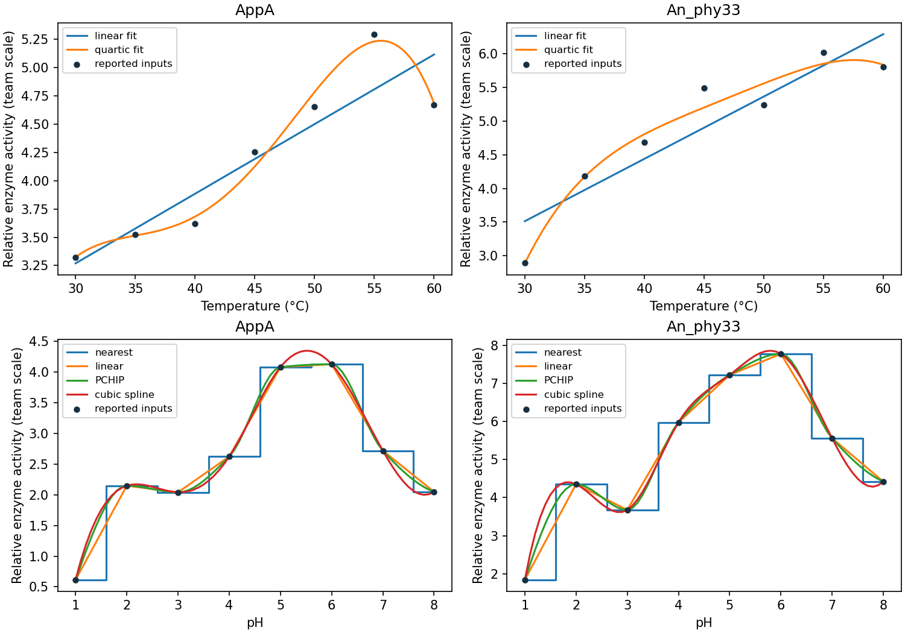

# 拟合与插值｜从植酸酶活性数据找下一轮测点

**课时** 50 分钟。你将用 iGEM 团队的公开数组复算四条曲线，用留点误差比较算法，再把预测的峰位改写成可验证的测量问题。

## 原理与选择

拟合把带噪声的数据压缩成一个规律。对多项式，最小二乘找一组系数，使实测值和预测值的残差平方和最小。四次多项式有五个系数，用七个点估计时自由度很少。线性拟合是简单基线，也无法表现区间内部有峰的形状。

插值让预测线经过所有输入点，用于回答“两个已测位置之间怎样变化”。输入测量带噪声时，曲线也会经过这些误差。区间外的预测是外推，需要独立理由和验证。

| 插值 | 怎么构造 | 适合看什么 |
|---|---|---|
| 最近点 | 取最近测点的值 | 阶梯对照或类别赋值 |
| 线性 | 相邻两点连直线 | 计算透明，无额外峰值 |
| PCHIP | 分段三次函数，匹配一阶导并限制段内斜率 | 需要平滑且希望保留数据形状 |
| 三次样条 | 分段三次函数，一阶和二阶导都连续，另加边界条件 | 展示平滑趋势，允许点间出现额外的弯折或峰 |

## 原项目怎么做

**Fujian-United 2023** 比较两种植酸酶在不同温度和 pH 下的相对活性，目的是为饲料添加剂评价可使用的条件。作者通过吸光度与磷酸盐标准曲线估算释放量。Model PDF 的表 1–2 记录每个条件三次平行测量，§3 列出拟合数组和 MATLAB 代码，§4 的图 3–4 给出预测曲线。温度是 30–60 °C 的七个水平，用四次最小二乘。pH 是 1–8 的八个水平，用 `interp1(...,'spline')`。两个自变量分别扫描，各在自身区间按 0.1 间隔找峰。Results 页另给出离散已测条件上的观察。[原 Model PDF](https://static.igem.wiki/teams/4870/wiki/model.pdf) · [原项目 Results](https://2023.igem.wiki/fujian-united/results)

## 跟做与核对

- [输入 CSV](../data/fujian_phytase_activity.csv) 转录原 MATLAB 的四组输入数组，采用原报告的相对活性尺度及保留位数。三次平行值见原文表 1–2。独立批次数与原始仪器级数据在练习中无法核对。
- [脚本](../examples/curve_fitting.py) 依次读 CSV、拟合、创建网格、找最大值、画曲线。NumPy 的 `Polynomial.fit` 在缩放坐标做最小二乘，减少高次幂数值问题。SciPy 的 `CubicSpline` 默认使用与该案例匹配的 not-a-knot 边界。原作者用 MATLAB，教学复算用 Python、NumPy、SciPy、Matplotlib，本机 CPU 即可。[MathWorks interp1](https://www.mathworks.com/help/matlab/ref/double.interp1.html) · [SciPy CubicSpline](https://docs.scipy.org/doc/scipy/reference/generated/scipy.interpolate.CubicSpline.html)

```bash
python examples/curve_fitting.py
```

| 轴 | 酶 | 原报告峰位 / 峰高 | 按公开代码复算峰位 / 峰高 |
|---|---|---|---|
| 温度 | AppA | 55.5 °C / 5.22368 | 55.5 °C / 5.23679 |
| 温度 | An_phy33 | 57.5 °C / 5.9070 | 57.5 °C / 5.90701 |
| pH | AppA | 5.5 / 4.3483 | 5.5 / 4.34845 |
| pH | An_phy33 | 5.8 / 7.8570 | 5.8 / 7.85704 |

四个峰位一致，AppA 峰高有两处小出入，差异原因未确认。打开 `build/curve_fitting/activity.png` 和 `model_comparison.csv`。对于 pH，两种酶的 PCHIP 和线性插值都把峰放在已测的 pH 6。样条落在 pH 5–6 之间。如果模型建议新增测点，先量峰附近，再补两侧，保留独立重复和误差。分别扫描无法说明温度和 pH 有没有交互作用。



## 评价与课堂题

留一验证时，脚本逐次拿掉一个区间内的测点，用其余点预测，端点保留以免混入外推。AppA 的 pH 样条留点 RMSE 约 0.278、线性约 0.598。An_phy33 的 pH 样条约 1.597、线性约 1.108。同一种插值对两条曲线的表现不同。用预测误差和采样间距评价峰位。

经典拟合和插值仍有用。噪声大时可尝试加权回归或平滑样条，有独立的测量方差才好估权重。有物理或生化约束时，优先测试满足约束的响应模型。要预测温度与 pH 联合作用，可开展有组合梯度的二维试验，再比较响应面或带不确定度的回归。

**课堂题** 在 `interior_validation_rmse` 中打印每次拿掉的 pH 和残差。哪一个点对 An_phy33 的样条影响最大？如果下一轮只能补三个 pH 点，说明你的选点理由。
