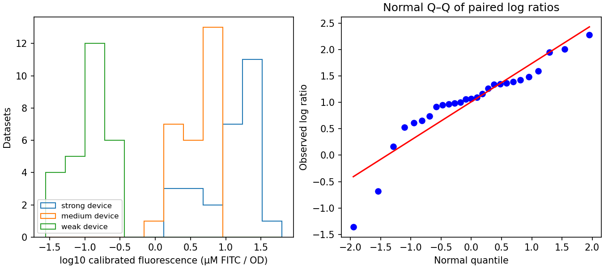

# 统计描述与推断｜iGEM InterLab 怎样比较不同实验室的读数

**课时** 65 分钟。你会用 iGEM 的公开论文补充数据做校准后质控，复算几何统计量，并选择适合配对数据的检验。

## 从样本到问题

总体是你希望结论适用的范围。独立实验单位决定样本量。同一孔反复读、同一块板多个孔、同一机构不同批次各有不同的独立性。在计算均值前，先画频数直方图、散点或箱图。均值和中位数表示位置，标准差、方差、极差表示离散。偏度描述分布尾部的不对称性，正态分布的原始峰度为 3，超额峰度为 0。估计时要报告采用的定义。

点估计给出一个数。区间估计反映在指定抽样模型下的精度。频率学派 95% 置信区间的 95% 描述反复用同一构造方法时覆盖真值的比例。双侧 $p$ 值是在零假设和模型都成立时，得到至少同样极端检验统计量的概率。演示中使用正态、$t$、$\chi^2$ 和 $F$ 分布。CDF 给累计概率，PPF 将概率变回分位点，PDF 是连续变量的密度。

## 原项目怎么做

Beal 等用 2016 iGEM InterLab 比较各实验室的荧光精度。研究将板读和流式数据分开。作者先处理背景与仪器校准，再比较任意单位、校准、归一化及基于对照的筛选。板读用 µM FITC/OD，流式为 MEFL，单位不可混在一起。板读校准数据在 S1 Table，原文 Methods 描述吸光度空白扣除和荧光标准曲线。作者用几何统计量比较五种处理方式，在正文 Fig. 2–4 讨论精度和可比性。补充文件含板读与流式报告表格，完整分析链的重跑需要足够的原始读数和处理细节。[原论文 Results、Methods and materials、Supporting information](https://doi.org/10.1371/journal.pone.0199432) · [S1 Table](https://doi.org/10.1371/journal.pone.0199432.s006)

## 跟做与验收

```bash
python examples/interlab_statistics.py
python examples/interlab_statistics.py --center 2.5102 --output build/statistics_sensitivity
```

1. [原 S1 Table CSV](../data/beal_2018_s1_bulk.csv) 每行是编号的数据集。看表头，区分设备读数、已校准对照的均值和设备的孔内统计。缺测保留为 NaN。只在需要对数的步骤要求正值，并记录丢掉多少行。
2. [脚本](../examples/interlab_statistics.py) 用正文 3.02 µM FITC/OD 作正对照中心，允许三倍区间。负对照须在 −0.01 至 0.5 µM FITC/OD，且两对照都须可用。原文报告 30/65，通过脚本可核对到 27/65。S1 的正对照中位数是 2.5102，和正文的 3.02 有差异。第二条命令把中心改成 CSV 中位数作敏感性对照，保留 28 个数据集。差异来源未确认，参数没有调到迎合论文的 30。检查 `device_summary.csv` 里每种处理的行数和可用正值数。
3. 对正值取对数后统计。几何均值为 $e^{\operatorname{mean}(\log y)}$，几何标准差为 $e^{\operatorname{sd}(\log y)}$，解释为乘除倍数。图 `build/statistics/interlab.png` 左边是校准并通过对照的数据直方图。
4. 教学问题是同一数据集中 strong 和 medium 的荧光比。对每行求 $\log(\mathrm{strong}/\mathrm{medium})$，以 0 为零假设值。在默认 27 个配对中，几何均值比约 2.752。一组 $t$ 区间为 2.045–3.704，但 Q–Q 图和偏度显示明显非正态。将其作为方法比较，同时报告配对中位数比 2.916、bootstrap 95% 区间 2.581–3.867 和符号检验。筛选后的结论适用于与该筛选规则相符的数据集，不能自然推广到所有实验室。
5. Python 的 CSV、NumPy、SciPy、Matplotlib 足够。本练习用本机 CPU。公开表是汇总数据，无法估计单孔到团队所有层次的噪声。



## 选择检验

| 问题 | 方法 | 注意 |
|---|---|---|
| 一个均值与目标比较 | 总体标准差已知时用 Z，否则用单样本 $t$ | Z 的标准差应来自设计或外部信息，不能把样本 SD 填进去当已知 |
| 两组独立均值比较 | Welch $t$，或在等方差有依据时用合并方差 $t$ | 同一实验室配对数据应对配对差检验 |
| 两组独立排序比较 | Wilcoxon 秩和 / Mann–Whitney U | 一般检验分布或相对排序，在形状相似等条件下才可解释为位置差 |
| 成对差的方向与大小 | Wilcoxon 符号秩 | 位置解释依赖差值分布近似对称，零值与并列需明确处理 |
| 成对差只看方向 | 符号检验 | 对非零差值按二项模型检验方向，信息更少但对离群差值更稳健 |
| 独立同分布样本是否接近指定分布 | Pearson $\chi^2$ 拟合优度，可辅以 Q–Q 图 | 分箱事先定义，保障期望频数。若用同批数据拟合参数，再用模拟估计零假设分布或采用适当自由度推导 |
| 正态性与方差 | 对称性和尾部用 D’Agostino–Pearson $K^2$；理想正态下用 $\chi^2$ 估 SD 区间，用 $F$ 比较两个方差 | 受偏态和极端值影响，先看数据形状，可考虑稳健尺度或 Levene 检验 |

脚本用同一份真实配对数据演示单样本 $t$、符号秩、符号检验和正态性诊断。另生成两组独立样本，演示 Z、Welch、合并方差 $t$、Wilcoxon 秩和、已知标准正态的 $\chi^2$ 拟合优度和 $F$ 方差比检验。模拟部分不承接真实研究的结论。不要试遍多个检验再挑 $p$ 值最小的报。先确定主要估计目标、检验方向和单位，再检查假设。报告效应量、区间和样本数；多终点或筛选阈值探索要注明。[SciPy stats 文档](https://docs.scipy.org/doc/scipy/reference/stats.html)

## 评价与课堂题

描述统计和传统检验仍是基础。跨板、跨批次和跨团队数据可用分层模型或按实验室成组重抽样。校准误差显著时，报告对阈值、读数范围和权重的敏感性。临界显著性没有办法弥补实验单位认错或过量删点。

**课堂题** 对比两次运行的正对照窗口、样本量和配对中位数。假设有一组新实验室数据，写下你会预先固定的三个质量规则，并说明在何时查看测试样本的结果。
